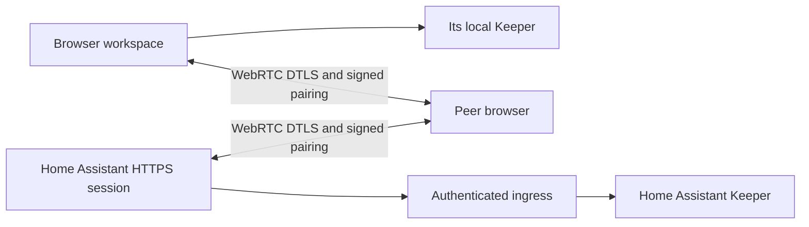

# Architecture

Doodle Tick combines an encrypted browser workspace with a trusted local Keeper. Native WebRTC connects browsers after signed invitations and two-sided spirograph comparison. A private garden uses one Keeper as its scorekeeper. Public DGT gardens and the prelaunch DVC certificate are separate mechanisms with separate authority.

## Source layout

| Location | Responsibility |
| --- | --- |
| `keeper/server.mjs` | Loopback service, witness receipts and asset allowlist |
| `keeper/vpn-network.mjs`, `rendezvous.mjs` | Local garden/directory compatibility routes; no VPN, peer listener or arbitrary remote proxy |
| `keeper/public/vpn-transport.mjs`, `vpn-description.mjs` | Native WebRTC adapter and bounded complete signaling descriptions |
| `keeper/public/spirograph-auth.mjs`, `peers.mjs`, `arcade-link.mjs` | Signed invitations, two-sided comparison and gated application channels |
| `keeper/garden-ledger.mjs` | Private garden ownership, balances, earnings and atomic trades |
| `keeper/public/core.mjs` | Existing creator identity, encryption, signatures and hourly color sequence |
| `keeper/public/doodleverse-coin*.mjs`, `doodleverse-gpu.mjs` | Signed prelaunch certificate, independent verifier and bounded GPU candidate search |
| `keeper/public/doodleverse-recipient.mjs`, `doodleverse-recipient-ui.mjs`, `doodleverse-wallet.mjs` | Additive v2 recipient signatures/work, public-record UI and restricted injected-wallet adapter |
| `keeper/public/public-chain*.mjs`, `contracts/` | Separate wallet-approved EVM garden and reproducible contract source |
| `keeper/public/file-store.mjs`, `licenses.mjs` | Encrypted library and signed license metadata |
| `doodletick/` | Home Assistant ingress, startup and one-time offline migration |
| `doodletick/keeper/` | Generated copy of the canonical runtime |

## Connections

Standalone HTTP binds only to loopback. The Home Assistant gateway listens inside its container for authenticated Supervisor ingress and exposes no host port. It requires the existing same-origin mutation header and forwards only to its loopback Keeper. The app requests no network capabilities, tunnel device, host networking, Docker access or Supervisor administration. Its own configuration folder is mounted read-only for verified import.

Names containing `vpn` and the `/vpn-api` prefix remain for local compatibility; they do not start a VPN. Removed remote bridges return an explicit unavailable response. Room codes list rooms on the same Keeper only. Separate Keepers pair via signed manual offers/answers. Native DTLS encrypts transport; spirographs authenticate the signed transcript. Application data waits for both confirmations. ICE gathering must finish with candidates; no STUN/TURN service is configured automatically, so cross-router connectivity is not assured.

Games remain player-hosted. Directory listings expire and do not migrate the host. Files require open, unlocked browsers; the Keeper does not provide unattended P2P storage. A future authenticated rendezvous/relay service requires a separate admission, revocation, abuse-control and operator design.

## Data and authority

| Data | Storage and backup |
| --- | --- |
| Creator private identity and writing | Encrypted browser vault; export its own backup |
| File library and arcade saves | Separate encrypted browser stores and exports |
| Witness identity, receipts and garden ledger | Keeper data directory; preserve original key and matching records together |
| DVC certificate/proof and wallet recipient | Public browser records and explicit exports; original v1 proof is retained separately; includes no private identity material |
| Legacy VPN files | Preserved inertly during compatible migration; unused by runtime |

Home Assistant uses `/data/keeper`. Earlier `/data/tailscale` files may remain for rollback but are not loaded by a daemon. Browser origins still define storage boundaries. One-time import validates every staged hash, refuses existing target data, flushes copies and records completion to prevent stale re-import.

Garden requests retain the existing signed formats, issuer pinning, serialized accounting and idempotent retries. Each Keeper has independent balances. The operator remains trusted to keep time, run the code and protect backups; signatures do not prevent a dishonest operator or snapshot rollback. Public DGT contracts have separate capped rules and wallet-confirmed actions. See [their guide](contracts/README.md).

The DVC certificate binds exactly one proposed 1,000,000-coin founder allocation. Existing creator signatures bind its public identity and canonical manifest; SHA-256 work binds the signed proposal. Export/import verifies strict formats, signatures, hash and difficulty. GPU candidates are checked with WebCrypto. Mining is opt-in and bounded, with cancellation on hiding, navigation, lock and changed consent. A proof establishes its stated target, not GPU provenance, canonical project authority, live genesis or a spendable balance. Total eventual network supply and future issuance remain unadopted.

## Wallet-recipient binding in 0.4b

The v2 recipient record embeds the immutable v1 proof and references its recomputed SHA-256 proof ID. The same P-256 creator key signs the new manifest in the `doodleverse-recipient-creator-v2` domain. The selected Ethereum wallet signs the `Doodleverse Founder Recipient` version-2 EIP-712 message, including the creator authorization hash. A fresh SHA-256 challenge commits the complete proposal and both signatures in the `doodleverse-recipient-work-v2` domain. The old v1 nonce is not reused as v2 work. Old v1 exports remain valid under their original verifier and are not silently rewritten.

`doodleverse-recipient-proposal-v2` can contain creator approval alone or both signatures; neither is a completed work proof. `doodleverse-recipient-proof-v2` adds independently checked work. Signed proposals are saved before GPU work, and public imports never resume signing/mining automatically. Authorization dates are Unix milliseconds, with a maximum 24-hour window. New signing/work requires a current authorization; archival verification reports expired or not-yet-valid status separately from signature integrity.

Wallet connection and signing use a separate, restricted adapter. The recipient feature has no transaction, token-approval, deployment or spending-permission path. It does not use the public DGT garden controller. Account, chain, provider, source-proof or creator changes invalidate pending work; a late wallet response cannot restore a cancelled attempt.

EOA signatures can be checked from the public record; that verifies a key's signature, not a chain's historical code classification. A deployed ERC-1271 account requires a read-only query on the declared chain and exact block hash, using EIP-1898 canonical-block selection plus number/hash checks. The UI requires an explicitly connected matching account/network for this query. An exported observation is not an offline proof of that state. ERC-6492 counterfactual signatures and EIP-7702 delegated accounts are unsupported by the connection flow. Unavailable or unsupported checks remain unverified rather than passing through an EOA fallback.

This record designates a proposed recipient. It supplies neither global uniqueness nor an issuance ledger: a creator can sign conflicting proposals, and future adoption needs explicit conflict, expiry and revocation rules. The public address is not proof of Coinbase account identity or official project authority. See [wallet-recipient behavior and limits](keeper/WALLET-RECIPIENT.md).

## Limits

Key comparison does not establish a unique human or authorship. License checks validate declared metadata and uses, not worldwide enforcement. Game replay checks establish transcript consistency, not independent anti-cheat. Native connections tested on one computer do not prove reachability between households. See [validation](keeper/VALIDATION.md) for exact observations.
