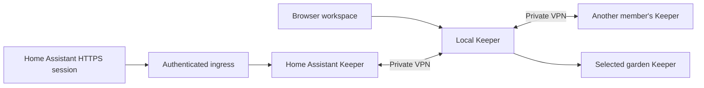

# Architecture

Doodle Tick combines an encrypted browser workspace with a trusted local Keeper. Members can connect Keepers through a private Tailscale network. A private garden uses one Keeper as its scorekeeper. The separate public mode uses a player's wallet and an independently deployed EVM ERC20 garden; Keeper balances are never imported into it.

## Source layout

| Location | Responsibility |
| --- | --- |
| `keeper/server.mjs` | Loopback browser service, signed witness receipts, asset allowlist |
| `keeper/vpn-network.mjs` and `rendezvous.mjs` | Private peer connections, directory, bounded message delivery |
| `keeper/garden-ledger.mjs` | Garden ownership, balances, earnings and atomic trades |
| `keeper/public/core.mjs` | Creator identity, signatures, encryption and hourly color sequence |
| `keeper/public/vpn-transport.mjs` | Browser-to-Keeper requests, ordered channels and retries |
| `keeper/public/spirograph-auth.mjs` | Signed pairing and explicit comparison by both participants |
| `keeper/public/file-store.mjs`, `licenses.mjs`, `peers.mjs` | Encrypted file library, content-license checks and peer transfers |
| `keeper/public/game-engine.mjs` and `arcade-*.mjs` | Player-hosted games, local saves, invitations and replay verification |
| `keeper/public/mushroom-*.mjs` and `dot-*.mjs` | Recipe normalization, interface, artwork and shared Dot Wave audio algorithms |
| `doodletick/` | Home Assistant app container, ingress adapter and private-network startup |
| `doodletick/keeper/` | Generated Home Assistant copy of the canonical runtime |
| `scripts/` | Runtime synchronization and repository validation |

## Connections

The standalone browser service binds to loopback. Its peer service binds to the private VPN interface. The browser channel adapter uses Keeper transport; there is no automatic public WebRTC fallback in this private edition. A room's host handles the simulation and forwards room messages. The directory introduces peers and expires stale listings; it is not a dedicated game server.

The Home Assistant container runs its own Tailscale device. The gateway accepts Supervisor ingress traffic, requires a same-origin header for mutations and forwards only to the container's loopback Keeper. The ingress build uses relative URLs and disables the offline service worker. It does not publish a browser port, enable a router DMZ, request host networking or grant the app Supervisor administrative access. A read-only mount of this app's own configuration folder supports a verified, one-time offline import before either daemon starts. It cannot read other apps' configuration folders.

## Data and authority

| Data | Where it lives | Backup requirement |
| --- | --- | --- |
| Creator private identity and writings | Encrypted browser storage | Export the encrypted vault |
| File library and arcade saves | Encrypted browser storage | Export their separate backups |
| Witness identity and receipts | Keeper data directory | Preserve the original identity and receipt files together |
| Garden ledger and generator recipes | Selected garden Keeper | Back up the ledger with its matching witness key |
| VPN device identity | Tailscale state | Keep private; do not run restored clones concurrently |

Standalone Keeper data is kept in its `.doodletick` directory. Home Assistant uses `/data/keeper` and `/data/tailscale`. A browser origin change does not migrate browser storage, and a Home Assistant app backup does not back up an encrypted browser vault.

Garden requests are signed by creator identities. One serialized ledger accepts valid sequences, settles completed UTC earning hours, checks funds and writes signed snapshots atomically. Retries use the same signed request. A market purchase transfers coins and generator ownership in one action. Completed seller earnings stay with the seller; the buyer receives future completed earning hours. Independent Keepers have independent balances.

The garden operator is trusted to run the code, keep time and protect backups. Signatures do not prevent an operator from changing software or restoring old state. Recipes and balances are visible to that operator. A generator purchase does not transfer copyright or prove exclusive ownership of a sound.

Private mining uses signed expiring challenges and the existing serialized garden action endpoint. Challenges bind ownership and time; caps persist across retries, transfers and restarts. A visible worker stops on hide, navigation, lock and mode changes. Public mining has separate contract rules and a separate wallet-confirmed proof submission; its low-difficulty proof is an earning mechanic, not the EVM network's consensus. See [the contract guide](contracts/README.md) for supply limits, source, tests and trust boundaries.

## Important boundaries

Spirographs help people compare signed keys; they do not prove a unique human or real-world identity. Creative Commons handling validates metadata and declared uses, and cannot stop copying outside the app. Game replay checks establish consistency of a supplied transcript, not independent anti-cheat.

Peer file sharing needs participating browsers to remain open. A Home Assistant Keeper does not yet provide unattended shared file storage. Rooms end when their player host leaves; restarting a directory removes its temporary invitations. HTTP recipe previews remain decorative, while vault and signed garden functions need HTTPS or the browser's localhost exception.

Changes to these boundaries need explicit design, tests and accurate user-facing explanations. See [the roadmap](ROADMAP.md).
